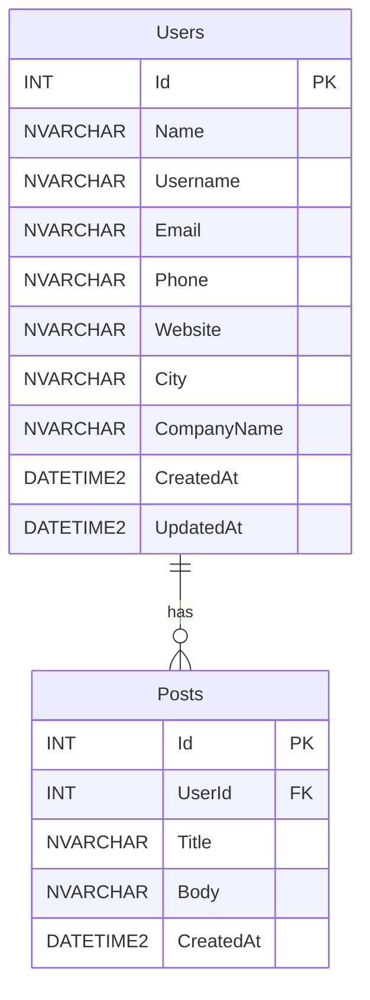

# ApiIntegrationApp

C# Console Application (.NET 8): бере дані з публічного API
[JSONPlaceholder](https://jsonplaceholder.typicode.com), виводить їх у консоль,
зберігає в SQL Server і показує збережені дані через `JOIN`.

## Технології
- .NET 8, C#
- `HttpClient` — HTTP-запити
- `System.Text.Json` — десеріалізація JSON
- `Microsoft.Data.SqlClient` — робота з SQL Server
- `Microsoft.Extensions.Configuration` — appsettings / User Secrets / змінні середовища

## API
| Endpoint | Опис |
|----------|------|
| `GET /users/{id}` | Дані користувача |
| `GET /posts?userId={id}` | Пости користувача (query-параметр змінює відповідь) |

## База даних
- Сервер: `DESKTOP-9G9V9M7`
- База: `FullStack`
- Таблиці: `Users` (1) → `Posts` (багато), зв'язок через Foreign Key `FK_Posts_Users`



### Ініціалізація схеми
Скрипт [`sql/init.sql`](sql/init.sql) ідемпотентний (`IF OBJECT_ID(...) IS NULL`).
Застосунок **виконує його автоматично при кожному старті**, тому вручну нічого робити не потрібно.
Для ручного запуску:
```powershell
sqlcmd -S DESKTOP-9G9V9M7 -d FullStack -E -C -i sql/init.sql
```

### Захист від дублікатів і SQL-ін'єкцій
- Усі запити параметризовані (`@Id`, `@Name`, ...) з явними типами `SqlDbType` і розмірами.
- `Users`: `IF NOT EXISTS` → `INSERT`; інакше `UPDATE` **лише якщо дані змінилися** (порівняння через `EXCEPT`).
- `Posts`: `IF NOT EXISTS` → `INSERT`; інакше запис пропускається.
- Перевірки виконуються з `WITH (UPDLOCK, HOLDLOCK)` — захист від гонки при паралельних запусках.
- Користувач і пости зберігаються в одній транзакції (або все, або нічого).

Повторний запуск з тим самим `userId` не створює дублікатів:
```
Користувач 1 (Bret): вже існує, без змін
Пости: додано 0, пропущено як дублікати 10
```

## Конфігурація

Секрети (рядок підключення, ключі API) **не зберігаються в коді чи репозиторії**.
Налаштування читаються з трьох джерел, кожне наступне перекриває попереднє:

| Пріоритет | Джерело | Для чого |
|-----------|---------|----------|
| 1 | `appsettings.json` | Несекретні значення за замовчуванням (BaseUrl, userId, таймаут) |
| 2 | User Secrets | Секрети для локальної розробки (зберігаються поза репозиторієм) |
| 3 | Змінні середовища | Перевизначення на сервері / CI |

### Варіант A — User Secrets (рекомендовано для розробки)
```powershell
dotnet user-secrets set "ConnectionStrings:FullStack" "Server=DESKTOP-9G9V9M7;Database=FullStack;Trusted_Connection=True;TrustServerCertificate=True;" --project src/ApiIntegrationApp

# Якщо API потребує ключа:
dotnet user-secrets set "Api:ApiKey" "<your-api-key>" --project src/ApiIntegrationApp

# Перевірка:
dotnet user-secrets list --project src/ApiIntegrationApp
```
Секрети зберігаються у `%APPDATA%\Microsoft\UserSecrets\<UserSecretsId>\secrets.json`.

### Варіант B — змінні середовища
Подвійне підкреслення `__` замінює `:` в імені ключа.
```powershell
# Лише для поточної сесії PowerShell:
$env:ConnectionStrings__FullStack = "Server=DESKTOP-9G9V9M7;Database=FullStack;Trusted_Connection=True;TrustServerCertificate=True;"
$env:Api__ApiKey = "<your-api-key>"
$env:Api__DefaultUserId = "3"

# Постійно для користувача Windows (потрібен перезапуск терміналу):
setx ConnectionStrings__FullStack "Server=DESKTOP-9G9V9M7;Database=FullStack;Trusted_Connection=True;TrustServerCertificate=True;"
```

Якщо рядок підключення не задано, програма завершиться з кодом `1` і зрозумілим повідомленням.

## Структура проєкту
```
FullStack/
├── ApiIntegrationApp.sln
├── README.md
├── sql/
│   └── init.sql                  # ідемпотентна схема Users/Posts
└── src/
    └── ApiIntegrationApp/
        ├── ApiIntegrationApp.csproj
        ├── appsettings.json          # несекретні налаштування
        ├── Program.cs
        ├── Configuration/
        │   ├── ApiSettings.cs        # модель секції "Api"
        │   └── AppSettings.cs        # завантаження та валідація конфігурації
        ├── Models/
        │   ├── User.cs               # DTO користувача (+ Address, Company)
        │   └── Post.cs               # DTO поста
        └── Services/
            ├── ApiService.cs         # HttpClient + System.Text.Json
            ├── ApiException.cs       # єдиний тип помилки API
            ├── DatabaseService.cs    # SqlClient: схема, параметризовані INSERT/UPDATE
            └── SaveResult.cs         # підсумок збереження
```

## Обробка помилок API

| Ситуація | Виняток | Повідомлення / код виходу |
|----------|---------|---------------------------|
| Статус ≠ 2xx (напр. 404) | `HttpRequestException` після `EnsureSuccessStatusCode()` | `API повернуло помилковий статус 404...`, код `2` |
| Немає мережі / DNS | `HttpRequestException` без статусу | `Не вдалося з'єднатися з API...`, код `2` |
| Таймаут | `TaskCanceledException` | `Перевищено час очікування...`, код `2` |
| Некоректний JSON | `JsonException` | `Не вдалося розібрати JSON...`, код `2` |
| Порожнє тіло / `null` / порожній список | `ApiException` | `API повернуло порожню відповідь...`, код `2` |
| Некоректний аргумент userId | — | код `1` |
| Помилка SQL Server (недоступний сервер, немає бази, FK тощо) | `SqlException` | опис + `[SQL <номер>]`, код `3` |

## Запуск
```powershell
dotnet build
dotnet run --project src/ApiIntegrationApp          # userId з конфігурації (за замовчуванням 1)
dotnet run --project src/ApiIntegrationApp -- 3     # userId=3 → інша відповідь API
```

## Стан розробки
- [x] Етап 1 — Ініціалізація проєкту
- [x] Етап 2 — Конфігурація
- [x] Етап 3 — API-клієнт
- [x] Етап 4 — Збереження в SQL Server
- [ ] Етап 5 — Виведення даних через JOIN
