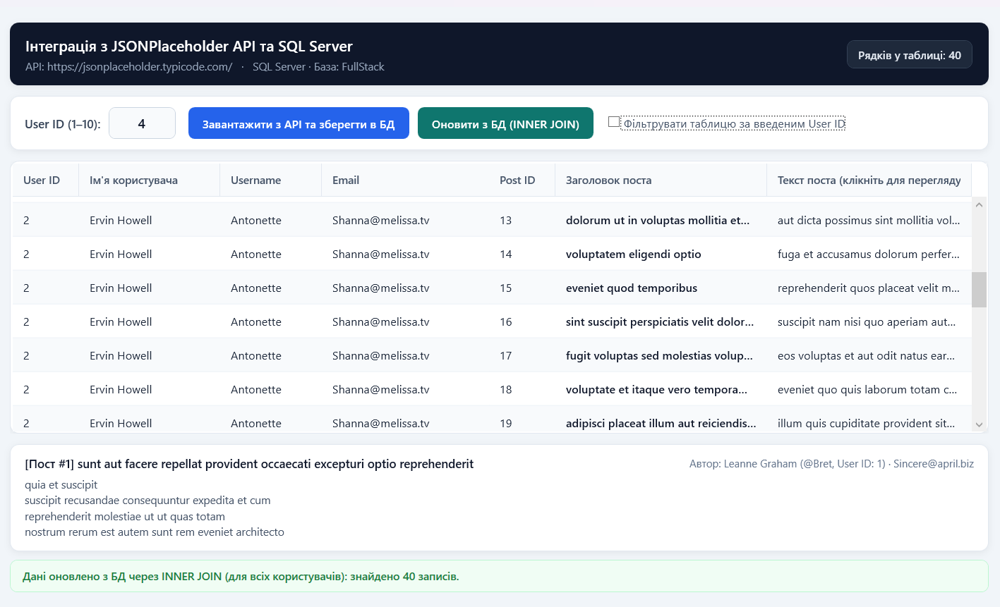
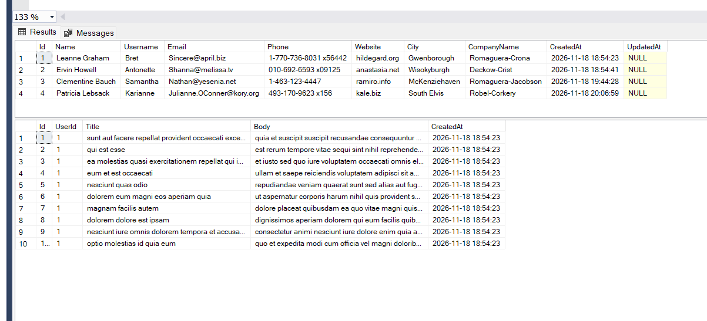

# ApiIntegrationApp

Навчальний проєкт на C# (.NET 8) для роботи з публічним REST API [JSONPlaceholder](https://jsonplaceholder.typicode.com) та базою даних **MS SQL Server (`FullStack`)**.

Рішення складається з трьох проєктів:
- **`ApiIntegrationCore`** — спільна бібліотека класів із клієнтом API, моделями даних, сервісом роботи з БД та конфігурацією.
- **`ApiIntegrationApp`** — консольний застосунок: завантажує дані користувача та його пости з API, зберігає їх у SQL Server без дублікатів і виводить у консоль результат об'єднання таблиць через `INNER JOIN`.
- **`ApiIntegrationWpf`** — десктопний WPF-застосунок із таблицею `DataGrid`, вибором `User ID`, фільтрацією та переглядом повного тексту постів.

## Технології
- .NET 8, C#, WPF (`net8.0-windows`)
- `HttpClient` та `System.Text.Json` — виконання HTTP-запитів і десеріалізація JSON
- `Microsoft.Data.SqlClient` — параметризовані запити та транзакції в SQL Server
- `Microsoft.Extensions.Configuration` — конфігурація через `appsettings.json`, User Secrets та змінні середовища

## Скриншоти роботи

### Десктопний WPF-інтерфейс (`ApiIntegrationWpf`)

*Головне вікно WPF-застосунку: таблиця `DataGrid` із даними `Users` ↔ `Posts` (`SELECT ... INNER JOIN`), панель керування `User ID` та блок перегляду обраного поста.*

### Дані у SQL Server (`FullStack`)

*Збережені записи в таблицях `dbo.Users` та `dbo.Posts` у базі даних `FullStack`.*

## Використані ендпоінти API

Базова адреса: `https://jsonplaceholder.typicode.com/`

- `GET /users/{id}` — отримання профілю користувача за його ідентифікатором.
- `GET /posts?userId={id}` — отримання списку постів конкретного автора (query-параметр `userId` фільтрує відповідь сервера).

У разі мережевих збоїв, таймаутів, некоректного статусу відповіді (наприклад, `404 Not Found`) або помилок десеріалізації `ApiService` генерує `ApiException` зі зрозумілим описом причини, а застосунок коректно обробляє помилку без аварійного завершення.

## Схема бази даних

Використовується база даних **`FullStack`** у MS SQL Server. Схема описана в ідемпотентному скрипті [`sql/init.sql`](sql/init.sql), який автоматично виконується при старті програми (`EnsureSchemaAsync`), якщо таблиці ще не створені.

Таблиці пов'язані відношенням один-до-багатьох (`Users` 1 → N `Posts`):

- **`dbo.Users`** — інформація про авторів:
  - `Id` (`INT`, **Primary Key**) — ідентифікатор користувача з API;
  - `Name` (`NVARCHAR(100)`), `Username` (`NVARCHAR(50)`), `Email` (`NVARCHAR(100)`) — основні дані;
  - `Phone` (`NVARCHAR(50)`), `Website` (`NVARCHAR(100)`), `City` (`NVARCHAR(100)`), `CompanyName` (`NVARCHAR(100)`) — додаткові поля профілю;
  - `CreatedAt`, `UpdatedAt` (`DATETIME2(0)`) — часові мітки створення та оновлення запису.

- **`dbo.Posts`** — пости користувачів:
  - `Id` (`INT`, **Primary Key**) — ідентифікатор поста з API;
  - `UserId` (`INT`, **Foreign Key** `FK_Posts_Users` → `dbo.Users(Id)`, `ON DELETE CASCADE`) — посилання на автора;
  - `Title` (`NVARCHAR(300)`) — заголовок поста;
  - `Body` (`NVARCHAR(MAX)`) — текст поста;
  - `CreatedAt` (`DATETIME2(0)`) — дата додавання в БД.

Усі SQL-запити (`INSERT`, `UPDATE`, `SELECT ... INNER JOIN`) параметризовані через `SqlCommand.Parameters`. Збереження користувача і його постів виконується в одній транзакції з перевіркою `IF NOT EXISTS`, тому повторні запуски з тим самим `userId` не створюють дублікатів.

## Структура проєкту

```text
FullStack/
├── ApiIntegrationApp.sln
├── README.md
├── docs/
│   ├── wpf-ui.png                    # скриншот WPF-застосунку
│   └── sql-database.png              # скриншот таблиць у SQL Server
├── sql/
│   └── init.sql                      # SQL-скрипт створення таблиць Users і Posts
└── src/
    ├── ApiIntegrationCore/           # спільна бібліотека (моделі, конфігурація, сервіси API та БД)
    │   ├── ApiIntegrationCore.csproj
    │   ├── appsettings.json
    │   ├── Configuration/
    │   ├── Models/
    │   └── Services/
    ├── ApiIntegrationApp/            # консольний застосунок
    │   ├── ApiIntegrationApp.csproj
    │   └── Program.cs
    └── ApiIntegrationWpf/            # десктопний WPF-застосунок
        ├── ApiIntegrationWpf.csproj
        ├── App.xaml / App.xaml.cs
        └── MainWindow.xaml / MainWindow.xaml.cs
```

## Швидкий старт (Запуск)

### 1. Клонування репозиторію
```powershell
git clone https://github.com/DerflerAnt/ApiIntegrationApp.git
cd ApiIntegrationApp
```

### 2. Налаштування підключення до SQL Server
Переконайтеся, що у вашому екземплярі SQL Server створена база даних `FullStack` (таблиці `Users` та `Posts` програма створить автоматично під час першого запуску).

Рядок підключення не зберігається у відкритому коді. Найзручніше задати його через **User Secrets**:
```powershell
dotnet user-secrets set "ConnectionStrings:FullStack" "Server=localhost;Database=FullStack;Trusted_Connection=True;TrustServerCertificate=True;" --project src/ApiIntegrationApp
```

Також підтримується налаштування через змінну середовища (або за потреби у локальному `appsettings.json`):
```powershell
$env:ConnectionStrings__FullStack = "Server=localhost;Database=FullStack;Trusted_Connection=True;TrustServerCertificate=True;"
```

### 3. Збірка та запуск
```powershell
# Збірка всього рішення
dotnet build

# Запуск консольної версії (за замовчуванням userId = 1)
dotnet run --project src/ApiIntegrationApp

# Запуск консольної версії для іншого користувача (наприклад, userId = 3)
dotnet run --project src/ApiIntegrationApp -- 3

# Запуск десктопного WPF-застосунку
dotnet run --project src/ApiIntegrationWpf
```
