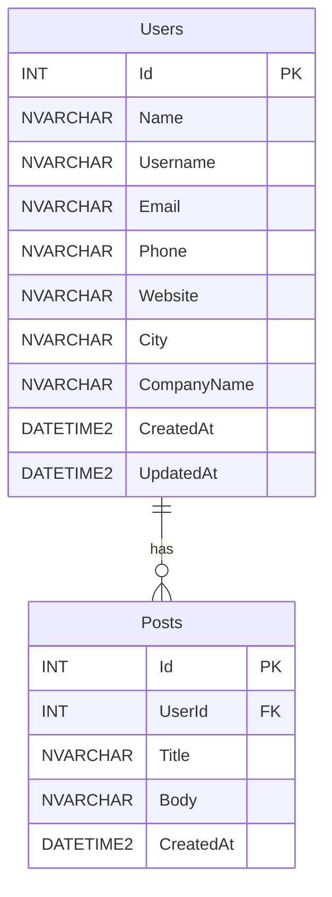

# ApiIntegrationApp (Console + WPF Desktop GUI)

Рішення (.NET 8) для інтеграції з публічним API [JSONPlaceholder](https://jsonplaceholder.typicode.com) та базою даних **SQL Server (`FullStack`)**:
- **`ApiIntegrationCore`** — спільна бібліотека класів (`HttpClient`, `System.Text.Json`, `Microsoft.Data.SqlClient`, конфігурація через `appsettings.json` + User Secrets + змінні середовища).
- **`ApiIntegrationApp`** — консольний застосунок, який отримує користувача та його пости з API, виводить їх у консоль, зберігає в SQL Server без дублікатів і відображає об'єднані дані через параметризований `SELECT ... INNER JOIN`.
- **`ApiIntegrationWpf`** — десктопний WPF-застосунок із графічним інтерфейсом (`DataGrid`), полем вводу `User ID`, кнопками завантаження з API у БД та оновлення таблиці з БД через `INNER JOIN`, а також фільтрацією за `User ID`.

## Технології
- .NET 8, C#, WPF (`net8.0-windows`)
- `HttpClient` — HTTP-запити
- `System.Text.Json` — десеріалізація JSON
- `Microsoft.Data.SqlClient` — робота з SQL Server (параметризовані запити й транзакції)
- `Microsoft.Extensions.Configuration` — `appsettings.json` / User Secrets / змінні середовища

## Скриншоти роботи (Демонстрація інтерфейсу та БД)

### 1. Десктопний WPF-інтерфейс (`ApiIntegrationWpf`)

*Графічний інтерфейс WPF-застосунку з таблицею `DataGrid` (відображення об'єднаних даних `Users` ↔ `Posts` через `SELECT ... INNER JOIN`), панеллю керування `User ID` та карткою перегляду повного тексту обраного поста.*

### 2. Збережені дані у SQL Server (`FullStack`)

*Вміст таблиць `dbo.Users` та `dbo.Posts` у базі даних SQL Server (`FullStack`), зв'язаних зовнішнім ключем `FK_Posts_Users`.*

## API
| Endpoint | Опис |
|----------|------|
| `GET /users/{id}` | Дані користувача |
| `GET /posts?userId={id}` | Пости користувача (query-параметр змінює відповідь) |

## База даних
- СУБД: Microsoft SQL Server (локальний екземпляр `localhost` або власний сервер)
- База: `FullStack`
- Таблиці: `Users` (1) → `Posts` (багато), зв'язок через Foreign Key `FK_Posts_Users`



### Ініціалізація схеми
Скрипт [`sql/init.sql`](sql/init.sql) ідемпотентний (`IF OBJECT_ID(...) IS NULL`).
Застосунок **виконує його автоматично при кожному старті**, тому вручну нічого робити не потрібно.
Для ручного запуску:
```powershell
sqlcmd -S localhost -d FullStack -E -C -i sql/init.sql
```

### Захист від дублікатів і SQL-ін'єкцій
- Усі запити параметризовані (`@Id`, `@Name`, ...) з явними типами `SqlDbType` і розмірами.
- `Users`: `IF NOT EXISTS` → `INSERT`; інакше `UPDATE` **лише якщо дані змінилися** (порівняння через `EXCEPT`).
- `Posts`: `IF NOT EXISTS` → `INSERT`; інакше запис пропускається.
- Перевірки виконуються з `WITH (UPDLOCK, HOLDLOCK)` — захист від гонки при паралельних запусках.
- Користувач і пости зберігаються в одній транзакції (або все, або нічого).

Повторний запуск з тим самим `userId` не створює дублікатів:
```
Користувач 1 (Bret): вже існує, без змін
Пости: додано 0, пропущено як дублікати 10
```

## Конфігурація

Секрети (рядок підключення, ключі API) **не зберігаються в коді чи репозиторії**.
Налаштування читаються з трьох джерел, кожне наступне перекриває попереднє:

| Пріоритет | Джерело | Для чого |
|-----------|---------|----------|
| 1 | `appsettings.json` | Несекретні значення за замовчуванням (BaseUrl, userId, таймаут) |
| 2 | User Secrets | Секрети для локальної розробки (зберігаються поза репозиторієм) |
| 3 | Змінні середовища | Перевизначення на сервері / CI |

### Варіант A — User Secrets (рекомендовано для розробки)
```powershell
dotnet user-secrets set "ConnectionStrings:FullStack" "Server=localhost;Database=FullStack;Trusted_Connection=True;TrustServerCertificate=True;" --project src/ApiIntegrationApp

# Якщо API потребує ключа:
dotnet user-secrets set "Api:ApiKey" "<your-api-key>" --project src/ApiIntegrationApp

# Перевірка:
dotnet user-secrets list --project src/ApiIntegrationApp
```
Секрети зберігаються у `%APPDATA%\Microsoft\UserSecrets\<UserSecretsId>\secrets.json`.

### Варіант B — змінні середовища
Подвійне підкреслення `__` замінює `:` в імені ключа.
```powershell
# Лише для поточної сесії PowerShell:
$env:ConnectionStrings__FullStack = "Server=localhost;Database=FullStack;Trusted_Connection=True;TrustServerCertificate=True;"
$env:Api__ApiKey = "<your-api-key>"
$env:Api__DefaultUserId = "3"

# Постійно для користувача Windows (потрібен перезапуск терміналу):
setx ConnectionStrings__FullStack "Server=localhost;Database=FullStack;Trusted_Connection=True;TrustServerCertificate=True;"
```

Якщо рядок підключення не задано, програма завершиться з кодом `1` і зрозумілим повідомленням.

## Структура проєкту
```
FullStack/
├── ApiIntegrationApp.sln
├── README.md
├── docs/
│   ├── wpf-ui.png                    # скриншот WPF-застосунку
│   └── sql-database.png              # скриншот таблиць у SQL Server
├── sql/
│   └── init.sql                      # ідемпотентна схема Users/Posts
└── src/
    ├── ApiIntegrationCore/           # спільна бібліотека бізнес-логіки та доступу до даних
    │   ├── ApiIntegrationCore.csproj
    │   ├── appsettings.json          # несекретні налаштування
    │   ├── Configuration/
    │   │   ├── ApiSettings.cs        # модель секції "Api"
    │   │   └── AppSettings.cs        # завантаження та валідація конфігурації
    │   ├── Models/
    │   │   ├── User.cs               # DTO користувача (+ Address, Company)
    │   │   ├── Post.cs               # DTO поста
    │   │   └── UserPostRow.cs        # DTO рядка результату INNER JOIN
    │   └── Services/
    │       ├── ApiService.cs         # HttpClient + System.Text.Json
    │       ├── ApiException.cs       # єдиний тип помилки API
    │       ├── DatabaseService.cs    # SqlClient: схема, параметризовані INSERT/UPDATE та SELECT INNER JOIN
    │       └── SaveResult.cs         # підсумок збереження
    ├── ApiIntegrationApp/            # консольний застосунок
    │   ├── ApiIntegrationApp.csproj
    │   └── Program.cs
    └── ApiIntegrationWpf/            # десктопний WPF-застосунок (GUI з DataGrid)
        ├── ApiIntegrationWpf.csproj
        ├── App.xaml / App.xaml.cs
        └── MainWindow.xaml / MainWindow.xaml.cs
```

## Обробка помилок API

| Ситуація | Виняток | Повідомлення / код виходу |
|----------|---------|---------------------------|
| Статус ≠ 2xx (напр. 404) | `HttpRequestException` після `EnsureSuccessStatusCode()` | `API повернуло помилковий статус 404...`, код `2` |
| Немає мережі / DNS | `HttpRequestException` без статусу | `Не вдалося з'єднатися з API...`, код `2` |
| Таймаут | `TaskCanceledException` | `Перевищено час очікування...`, код `2` |
| Некоректний JSON | `JsonException` | `Не вдалося розібрати JSON...`, код `2` |
| Порожнє тіло / `null` / порожній список | `ApiException` | `API повернуло порожню відповідь...`, код `2` |
| Некоректний аргумент userId | — | код `1` |
| Помилка SQL Server (недоступний сервер, немає бази, FK тощо) | `SqlException` | опис + `[SQL <номер>]`, код `3` |

## Запуск
```powershell
dotnet build

# 1. Консольний застосунок:
dotnet run --project src/ApiIntegrationApp          # userId з конфігурації (за замовчуванням 1)
dotnet run --project src/ApiIntegrationApp -- 3     # userId=3 → інша відповідь API

# 2. Десктопний WPF-застосунок (GUI з таблицею DataGrid):
dotnet run --project src/ApiIntegrationWpf
```

## Стан розробки
- [x] Етап 1 — Ініціалізація проєкту
- [x] Етап 2 — Конфігурація
- [x] Етап 3 — API-клієнт
- [x] Етап 4 — Збереження в SQL Server
- [x] Етап 5 — Виведення даних через JOIN
- [x] Етап 6 — Спільна бібліотека `ApiIntegrationCore` та десктопний WPF-інтерфейс `ApiIntegrationWpf`
